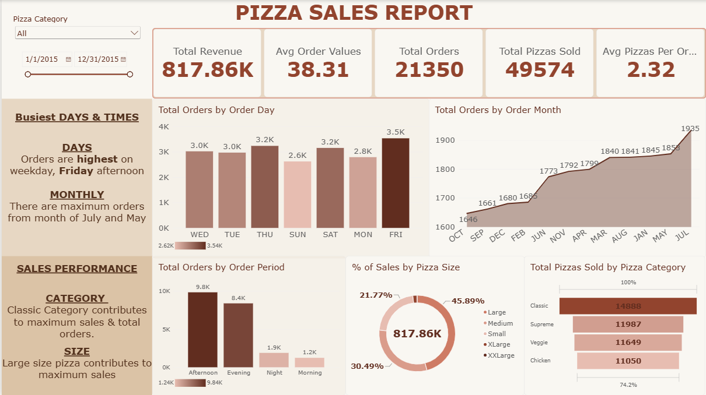

# Pizza Sales Analysis – Power BI

## Project Overview
This project uses Microsoft Power BI to analyze pizza sales data and identify sales trends, customer ordering patterns, and product performance. The dashboard provides insights into business performance and highlights the best- and worst-selling pizza products.

## Project Objectives
- Analyze overall pizza sales performance.
- Identify the busiest days and months for orders.
- Understand sales distribution across pizza categories and sizes.
- Identify the top 5 and bottom 5 pizzas based on revenue, quantity sold, and total orders.
- Generate insights to support data-driven business decisions.

## Tools & Technologies
- Microsoft Power BI
- Power Query for data cleaning and transformation
- DAX for calculated columns and measures
- Data modeling and visualization

## Dashboard Overview
### Page 1: Sales Overview
Focuses on overall sales performance and customer ordering patterns.

**Busiest Days & Times**
- Orders are highest on weekdays, particularly Friday afternoons.
- July and May record the highest monthly order volumes.

**Sales Performance**
- The Classic pizza category contributes the most to total revenue and orders.
- Large-sized pizzas contribute the most to revenue.

### Page 2: Best & Worst Sellers
Evaluates individual pizza performance based on three key metrics.

**Top Performers**
| Metric | Best-Selling Pizza |
|---|---|
| Highest Revenue | Thai Chicken Pizza |
| Highest Quantity Sold | Classic Deluxe Pizza |
| Highest Total Orders | Classic Deluxe Pizza |

**Lowest Performers**
| Metric | Lowest-Performing Pizza |
|---|---|
| Lowest Revenue | Brie Carre Pizza |
| Lowest Quantity Sold | Brie Carre Pizza |
| Lowest Total Orders | Brie Carre Pizza |

## Project Files
- `README.md` – Project documentation.
- `Pizza_Sales_Analysis.pbix` – Interactive Power BI dashboard.
- `Pizza_Dashboard.docx` – DOCX export of the two-page dashboard for easy viewing.
- `Sales_dashboard.png` – Dashboard preview.
  
- `Best_Worst_dashboard.png` – Dashboard preview.

## Key Business Insights
- Weekdays, especially Friday afternoons, represent important ordering periods.
- July and May show the highest monthly order volumes.
- Classic pizzas and large-sized pizzas are important contributors to sales performance.
- Classic Deluxe Pizza leads in both quantity sold and total orders.
- Brie Carre Pizza consistently ranks lowest across revenue, quantity sold, and total orders.

## Conclusion
This analysis provides an overview of pizza sales performance and customer ordering patterns. The findings can help the business understand popular products, identify weaker-performing items, and make more informed decisions regarding sales strategies and product offerings.
